<h1 align="center">⚡ NOXHUB | YUSUF ⚡</h1>

<h3 align="center">
  👋 Hey, I'm Yusuf — Developer from 127.0.0.1
</h3>

  

  

  
  
  

---

## 👨‍💻 ABOUT ME

- 🚀 Developer from Mars.
- 🌱 Currently learning **Flutter, Python & Java**.
- 💻 Interested in Full Stack Development.
- 🐧 Linux & Open Source enthusiast.
- ⚡ Hobbies: Gaming, Coding, Exploring Technology.
- 🔥 Errors are my best compiler; my brain works during runtime crashes.

---

## 🛠️ LANGUAGES & TECHNOLOGIES

  

---

## 📊 GITHUB STATISTICS

  
  

  

---

## 🐍 CYBER SNAKE ARENA

  <picture>
    <source media="(prefers-color-scheme: dark)" srcset="https://raw.githubusercontent.com/Shaikhyusufdev/Shaikhyusufdev/output/github-contribution-grid-snake-dark.svg" />
    <source media="(prefers-color-scheme: light)" srcset="https://raw.githubusercontent.com/Shaikhyusufdev/Shaikhyusufdev/output/github-contribution-grid-snake.svg" />
    
  </picture>

---

## 👾 NOXHUB ARCADE ZONE

### 🟡 PAC-MAN

  <picture>
    <source media="(prefers-color-scheme: dark)" srcset="https://raw.githubusercontent.com/Shaikhyusufdev/Shaikhyusufdev/output/pacman-contribution-graph-dark.svg" />
    
  </picture>

### 🚀 GALAGA

  <picture>
    <source media="(prefers-color-scheme: dark)" srcset="https://raw.githubusercontent.com/Shaikhyusufdev/Shaikhyusufdev/output/galaga-contribution-graph-dark.svg" />
    
  </picture>

### 💣 BOMBERMAN

  <picture>
    <source media="(prefers-color-scheme: dark)" srcset="https://raw.githubusercontent.com/Shaikhyusufdev/Shaikhyusufdev/output/bomberman-contribution-graph-dark.svg" />
    
  </picture>

### 💠 MINESWEEPER

  <picture>
    <source media="(prefers-color-scheme: dark)" srcset="https://raw.githubusercontent.com/Shaikhyusufdev/Shaikhyusufdev/output/minesweeper-contribution-graph-dark.svg" />
    
  </picture>

---

## 📈 CONTRIBUTION ACTIVITY

  

---

## ⚡ NOXHUB COMMAND CENTER

  

| SYSTEM | STATUS |
|:---:|:---:|
| 🖥️ Developer | `YUSUF` |
| 🌐 Base | `127.0.0.1` |
| ⚡ Codename | `NOXHUB` |
| 🧠 Learning | `Flutter / Python / Java` |
| 💻 Mission | `BUILD SOMETHING INSANE` |
| 🔥 Mode | `ALWAYS BUILDING` |

  
  
  

  <b>╔══════════════════════════════════════╗</b> 
  <b>║ &nbsp;&nbsp;&nbsp;&nbsp; NOXHUB — END OF TRANSMISSION &nbsp;&nbsp;&nbsp;&nbsp; ║</b> 
  <b>╚══════════════════════════════════════╝</b>

  <i>"I don't fear bugs. I create them, then debug them."</i>

---

## 👁️ PROFILE VISITORS

  

<h3 align="center">⚡ CODE • CREATE • DEBUG • REPEAT ⚡</h3>

  <i>Made with ❤️ by Yusuf | NOXHUB</i>

